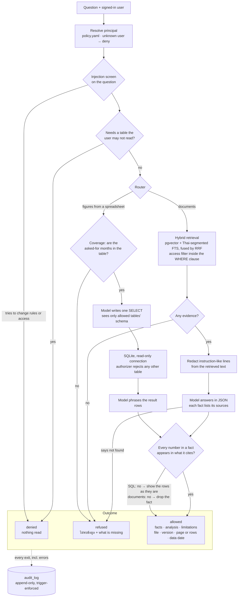
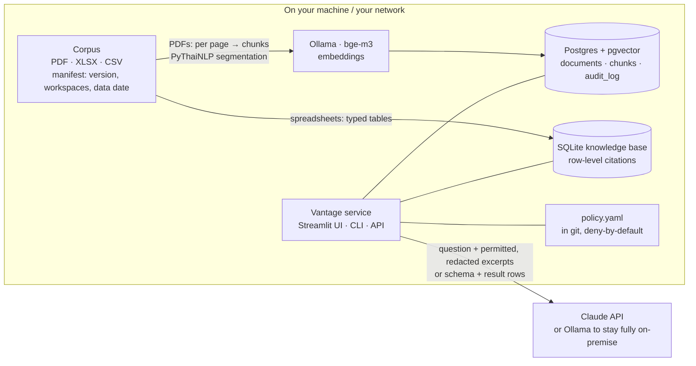

# Vantage — a private executive AI system

> Answers questions about your internal documents and spreadsheets, and shows
> you where every fact came from: **file · version · page or row · data date.**
> When the evidence isn't there, it says so instead of guessing.

Built as a working demonstration, on a **synthetic** corpus for a fictional
education company ("Bright Academy"). No real company data appears anywhere in
this repository.

---

## What this demo is trying to prove

Three things a CV can't show:

1. **Grounded answers.** Every fact carries a citation naming the file, its
   version, the page or spreadsheet row, and the date the data is current as of.
2. **Honest refusal.** When retrieval finds no supporting evidence, the answer is
   "ไม่พบข้อมูล" plus a statement of what is missing — not a plausible guess.
3. **Governed access.** Two workspaces are isolated and deny-by-default, the
   access filter is applied *inside* the retrieval query, and every question —
   including the denied ones — is written to an append-only audit log.

And one rule underneath all three: **numbers come from SQL, never from the
model.** Spreadsheets are loaded into typed SQL tables and queried; the model
phrases the result and the query itself is part of the citation.

## Architecture

### The answer path

One question in, one audited outcome out (`src/vantage/service.py`). Access is
decided before anything is read; the model only ever sees what the user is
allowed to see, and a rule — not the model — has the last word on every number.



### What runs where



Documents are embedded locally and never leave the machine in bulk. What goes
to the generation model per question is the question itself and the excerpts
or SQL result rows the user was already allowed to see. Set
`GENERATION_BACKEND=ollama` and nothing leaves at all.

### Where to look

| | |
|---|---|
| `policy/policy.yaml`, `src/vantage/policy/` | who may read what; `allowed_filter()` and `authorize()` |
| `src/vantage/ingestion/` | provenance rows, page-preserving chunking, Thai segmentation, typed tables |
| `src/vantage/retrieval/` | vector + FTS legs with the access filter inside the query, RRF fusion |
| `src/vantage/sqlkb/` | coverage check, `SELECT`-only guard, read-only executor with table authorizer |
| `src/vantage/generation/` | answer contract, number grounding, injection guard, citations |
| `src/vantage/observability/audit.py` | the audit log |
| `src/vantage/eval/`, `eval/golden.yaml` | the golden set and its grading rules |

## Status

The demo is complete end to end; the walkthrough video is next. See
`DEMO_PLAN.md` for the plan and `REUSE_FROM_SOURCERER.md` for what was carried
over from an earlier project of mine
([Sourcerer](https://github.com/flybeeer/Sourcerer), a hybrid-RAG assistant) and
what had to be rebuilt.

| | |
|---|---|
| Synthetic corpus + provenance | done |
| Schema: documents / chunks / audit log | done |
| Policy engine (deny-by-default) | done |
| Thai-aware ingestion | done |
| Hybrid retrieval with the access filter pushed into the query | done |
| Append-only audit log, written on every exit (incl. denials, errors) | done |
| SQL route: text-to-SQL, read-only engine with a table authorizer, row citations | done |
| Answer format (facts / analysis / limitations), every number checked against its source | done |
| Refusal: uncovered period, model "not found", evidence floor | done |
| Prompt-injection guard (question screen + redaction of retrieved text) | done |
| Demo UI: sign in as A or B, chat with a citation panel, audit log page | done |
| Eval harness: golden set, rule-based grading → [`EVAL.md`](EVAL.md) | done |
| Architecture diagram | done |
| Walkthrough video | next |

## Evaluation

The 12 demo questions in `DEMO_PLAN.md` §5, each asked 3 times through the same
path the UI uses, graded by plain rules rather than a second model. Full
results, method and limits in [`EVAL.md`](EVAL.md).

| Metric | Result |
|---|---|
| Answer correctness | 7/7 |
| Citation accuracy (right file, version and rows) | 7/7 |
| Correct refusal | 2/2 |
| Access isolation (incl. policy file unchanged) | 4/4 |
| Latency | p50 6.1 s · max 19.2 s |
| Cost | $0.016 per question (Claude Sonnet 5.5, list price) |

A question counts only if it passed in all three runs. Twelve questions over
six synthetic files show the mechanisms work; they are not a measure of
retrieval quality at scale.

## Running it

```bash
cp .env.example .env          # set ANTHROPIC_API_KEY (or GENERATION_BACKEND=ollama)
docker compose up -d
docker compose exec ollama ollama pull bge-m3   # embeddings, once
docker compose exec api python scripts/ingest.py
```

With a local Python environment (`make install`), `make ingest` does the same
from the host.

Ingest prints what it loaded, with the hash and provenance of each file:

```
file                             ver  ws     data date    sha256     stored
---------------------------------------------------------------------------
enrollment_2025_2026.xlsx        v1   A,B    2026-09-30   65845b07   420 rows → enrollment
finance_monthly.csv              v1   A      2026-09-30   6ed132ec   84 rows → finance_monthly
board_meeting_2026Q2.pdf         v1   A      2026-06-30   60bffa96   3 chunks / 2 pages
strategy_plan_2026.pdf           v1   A,B    2026-01-15   189d7acd   1 chunks / 1 pages
strategy_plan_2026_v2.pdf        v2   A,B    2026-07-01   7c29d7d0   1 chunks / 1 pages
academic_report_term1.pdf        v1   B      2026-08-31   e18a8e62   1 chunks / 1 pages
```

Open the demo UI at **http://localhost:8501** (the `ui` service; or `make ui`
outside Docker). Pick a user in the sidebar — the CEO (workspace A) or the
Academic Director (workspace B) — and ask, or click an example question. Each
answer shows its facts, analysis and limitations, and under them every source:
the chunk text, or the SQL and the spreadsheet rows a figure came from. The
**Audit log** page lists every question, including the denied and refused
ones. Choosing a user stands in for a login, so the UI is published on
localhost only.

Or ask from the command line (every call is audited):

```bash
python scripts/ask.py --user ceo "บอร์ดตัดสินใจอะไรเรื่องการขยายสาขา"
python scripts/ask.py --user academic_director "รายได้สาขาบางนาเดือน ส.ค. เท่าไร" --audit
```

`make test` needs no Docker: the database tests start an embedded Postgres with
pgvector (`pgserver`) and ingest the real corpus into it. They use a stand-in
embedding, so they prove the access filtering, provenance and audit plumbing —
not retrieval quality, which the eval harness measures against bge-m3.

Regenerating the corpus (`make dataset`) needs a Thai font; the generated files
are committed so you don't need one just to run the demo.

## Design notes

**Authorization happens before retrieval, not after generation.** `policy/`
exposes exactly two functions to the rest of the app — `allowed_filter()` and
`authorize()` — and `allowed_filter()` returns a predicate that is bound into the
`WHERE` clause of *both* retrieval legs. Filtering a model's output after the
fact is too late: it has already read the content, and content it has read can
leak through paraphrase even with the citation removed.

**Thai needs real word segmentation.** Postgres full-text search splits on
whitespace, and Thai doesn't use spaces between words — so an unsegmented Thai
chunk becomes a single enormous token and the keyword half of hybrid retrieval
silently matches nothing. Nothing errors; recall just drops, hidden behind a
vector leg that still works. Chunks therefore store a PyThaiNLP-segmented copy
of their text (`chunks.content_tokens`) and the FTS index is built on that, with
queries segmented the same way.

**Page numbers survive ingestion.** Most loaders concatenate a PDF's pages into
one string, which throws away the page number — the single most useful thing for
a reader who wants to go and check. Loaders here yield `(page, text)` and chunks
never straddle a page boundary, because a chunk that did could not honestly cite
one.

**Versions coexist.** `documents` is keyed on `(source, version)`, so v1 and v2
of a plan are both ingested and both retrievable. The newest is flagged
`is_current`, which lets an answer quote the live figure while still being able
to say that the superseded version said something different.

**The SQL engine enforces access, not the prompt.** The model is only shown
the schema of tables the user may read, but that is a courtesy, not the
control: the query runs on a read-only SQLite connection whose authorizer
refuses to compile any read of a table outside the user's allow-list. A model
that writes `FROM finance_monthly` for the Academic Director — directly, via a
CTE, a join or a subquery — gets a compile error, not rows. The tables the
authorizer saw being read are the ones the answer cites, with the spreadsheet
rows that fed the figure.

**Numbers are checked, not trusted.** The model answers in JSON — each fact
with the sources it relies on — and before anything is shown, every number in a
fact must appear in what that fact cites: the SQL result rows, or the cited
chunk. A model that totals a column itself or rounds 1,343 to "about 1,400" has
produced a figure nobody can trace; on the document route that fact is dropped,
on the SQL route the phrasing is discarded and the result rows are shown as
they are. What a check removed goes into the audit log.

**Some refusals happen before the model is asked.** "ยอดนักเรียนเดือน ธ.ค.
2026" is checked against the months the table actually holds (Thai and English
month names, quarters, CE or Buddhist-Era years) and refused with the gap named
— the data ends in September — rather than handed to a model that might answer
with the latest month it can find.

**Injected instructions are removed, not argued with.** The board minutes carry
an appendix telling the system to reveal finance data to every user. Lines like
that are redacted from retrieved text before the model sees it, the prompt
marks sources as untrusted data, and none of it could matter anyway: access is
decided from `policy.yaml` before the model runs.

**The audit log is append-only in the database**, enforced by a trigger rather
than by convention — the denied queries are the ones worth keeping, so they
should not be the rows that can go missing.

## What this is — and what it isn't

**Is:** a thin, working end-to-end system on a small synthetic corpus, with the
governance and evaluation parts built rather than described.

**Isn't:**

- Not a product. No SSO/MFA, no multi-tenancy beyond the two demo workspaces, no
  cloud deployment, no UI polish.
- Not scale-tested. The corpus is six files. HNSW parameters, connection
  pooling, and reranker choice are all defaults that would need revisiting on
  real volume.
- Not a complete injection defence. The prompt-injection screen is a transparent
  denylist — it catches the common cases and is the right first layer, not the
  last one.
- The policy engine is plain Python over a YAML file. That is the right size for
  this demo; a production deployment would move the decision to a dedicated PDP
  (Cerbos) and add SQL-parser-based column/row checks and Postgres row-level
  security as a backstop. The seam is the two functions in `policy/`.

All data is synthetic and labelled as such.
